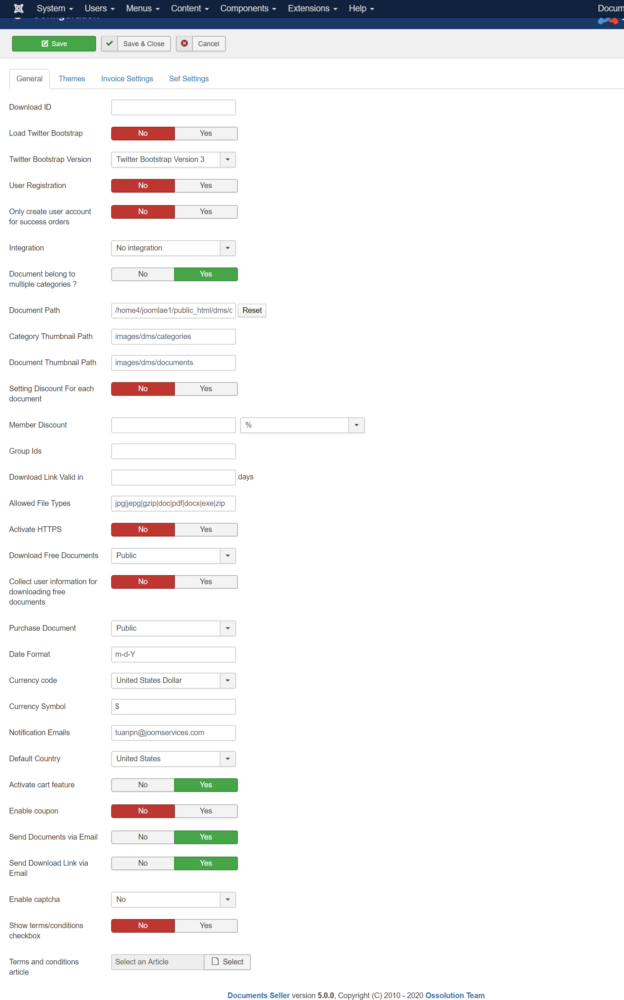

During the installation process, **DMS** will generate default configuration data. However, you should still review all config options and change it to meet your own requirement if needed.

To review and change Configuration, go to **Documents Seller** => **Configuration**. When you do that, the screen below will be displayed:

>>>>> To see the meaning of a config option / parameter, you can hover the moose over the name / title of that config option

As most of the config options are very easy to understand, in the section below, we will just explain / review the most importants config options. If there are other options which are not mentioned here and you don't understand, feel free contact us for support. We are available to assist you whenever you want / you need.

## General
1. **Load Twitter Bootstrap**: This should be set to **No** unless your site template is built base on a frontend framework not supported by **DMS** (currently, **DMS** supports **Twitter Bootstrap 2**, **Twitter Bootstrap 3**, **Twitter Bootstrap 4** and **UIKIT3**).
2. **Twitter Bootstrap Version**: Default to **Twitter Bootstrap version 2** because most of Joomla templates are buitl base on twitter bootstrap 2). If your site template is built base on Twitter Bootrap 3, Twitter Bootstrap 4 or UIKIT3, set this confict option to the appropriate value.
3. **User Registration**: If set to Yes, users will be allowed to enter username and password to register for an account on your site while purchasing your docuemnts. Have an account will allow them to login to your site, access to Orders History page to download documents later, so this should be set to Yes.
4. **Enable Captcha**: If you want to prevent spam bots from creating spam orders, set this config option to Yes. You will also configure captcha plugin on your site, see [https://docs.joomla.org/J3.x:Google_ReCaptcha](https://docs.joomla.org/J3.x:Google_ReCaptcha) for instructions. Further more, you will also need to go to System -> Global Configuration, set **Default Captcha** config option to the captcha plugin which you configured.
5. **Enable Coupon**: If you setup coupons in **DMS** and want to allow users to enter coupon code on order form to get discount for their purchase, please set this config option to **Yes**.
6. **Purchase Document**: Choose an Access Level here (usually Public) and only users has this Access Level can purchase documents on your site.
7. **Notification Emails**: The emails you want to receive notification when someone purchases documents on your site. If you want to user multiple emails, separate these emails by comman. For example: email1@domain.com,email2@joomdonation.com

## Themes
1. **Categories per Page**: Determine how many categories will be displayed per page on **Categories List** menu option.
2. **Documents per Page**: Determine how many documents will be displayed per page.
3. **Number of Columns in Column Layout**: Determine how many documents will be displayed per row on Documents List Columns Layout.
4. **Show sort options**: Set to **Yes** to allow users choose how documents will be ordered on your site (By Ordering, By Title, By Created Date or By Price.
5. **Default sort option** and **Default sort direction**: Determine the ordering of documents display on frontend of your site.

## Invoice Settings
1. **Activate Invoice Feature**: Set to **Yes** if you want **DMS** to generate invoice and send to customers when they purchase documents on your site.
2. **Invoice Format**: Control the layout of the invoice which will be generated.

## Sef Settings
1. **Insert Document ID**: Sometime, you might have to set this config option to **Yes** to avoid routing error when there is document has some alias with other document to avoid routing error. 
