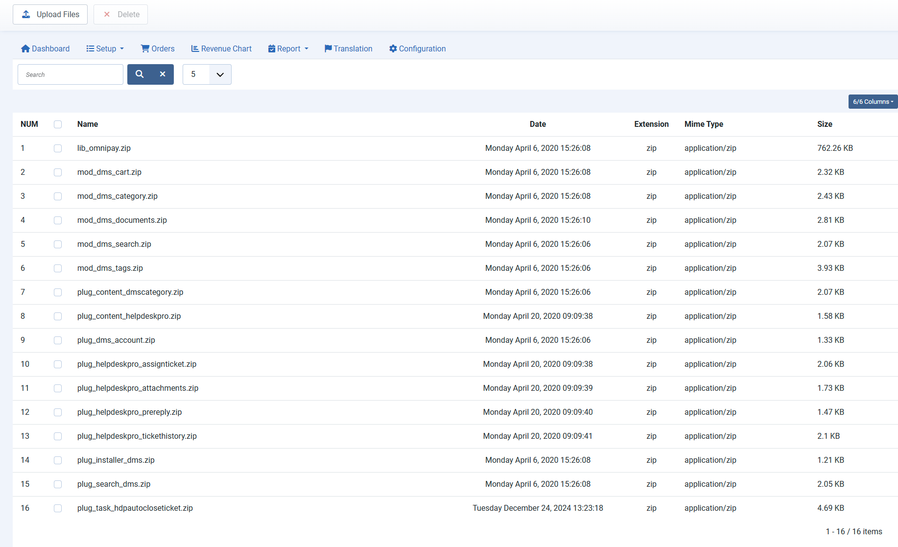
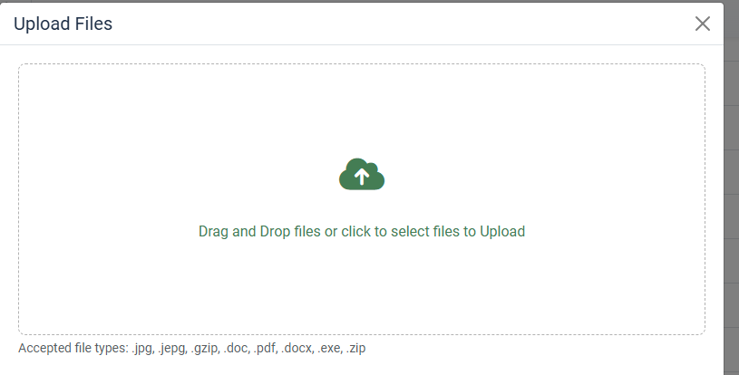

Upload the files you want to sell or offer as free downloads, then select the file to deliver when you create a document.

## Check the upload settings

In the Joomla administrator, open **Documents Seller → Configuration** and check these settings on the **General** tab.

- **Documents Path** is the absolute path to the storage folder on your server. By default, Documents Seller uses the `documents` folder in your Joomla site root. Joomla must be able to write to this folder for browser uploads.
- **Allowed File Types** controls which file extensions the browser uploader accepts. Enter extensions without leading dots and separate them with `|`, as in `pdf|zip|docx`. The document editor also uses this setting to filter its file list.

See [Files, Downloads, and Emails](/getting-started/configuration/files-downloads-and-emails) for more about file storage settings.

## Upload through the Joomla administrator

1. Go to **Documents Seller → Files** and click **Upload Files**.
2. Drag one or more files into the upload area, or click the area to select files from your computer. Uploads start automatically.
3. When the uploads finish, close the dialog and refresh **Files** to confirm that the uploaded files appear. Clear the search box or search for the file by name if you do not see it.

The browser uploader accepts files up to 256 MiB each. Your hosting server may impose a lower limit. If an upload fails, check the file type, file size, and write permissions for **Documents Path**. The browser uploader also rejects a file if a file with the same name already exists.

## Transfer large files directly to the server

If a file exceeds the browser or server upload limit, use SFTP or your hosting control panel's file manager to copy it to the top level of the **Documents Path** folder. The **Files** list and the document editor look only at that level. Refresh **Documents Seller → Files** to confirm the transfer.

## Attach a file to a document

Open **Documents Seller → Documents**, create or edit a document, and select the uploaded file in **Choose File**. Save the document. If the file appears under **Files** but is missing from **Choose File**, check that its extension is included in **Allowed File Types**. To deliver several files with one document, put them in a single ZIP archive, upload the archive, and select it in **Choose File**. See [Documents](/setup/documents) for the rest of the document setup.

## Replace or delete an uploaded file

To update a download, you can upload the new version under a different name and select it in **Choose File**, or replace the file directly on the server using the same filename. Replacing a file under the same name updates the download for every document that uses it.

Before deleting a file, assign a replacement to any document that still uses it. Then select the old file in **Files** and click **Delete** to remove it from the server.
