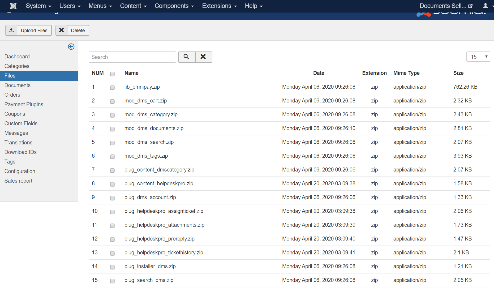
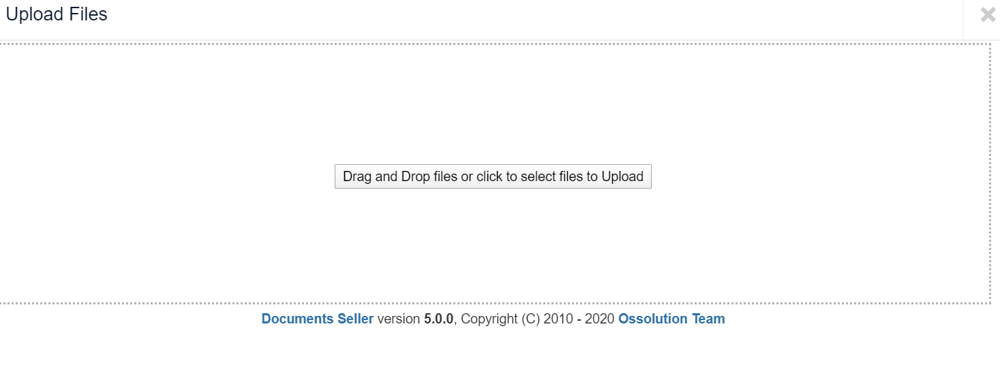

The first thing you should do is upload the files you want to sell to Documents Seller. There are two ways to upload files:

1. Go to **Documents Seller** -> **Files**, you will see a list of files which were uploaded before. Click on **Upload Files** button, there will be a popup window displayed to allow you do upload files. You can drag and drop multiple files here to upload or click on the button to select multiple files to upload.
2. In case your files are too bigs and could not be uploaded via web interface (some servers limit the size of files which can be uploaded to small size like 2MB), you can upload files via FTP, too. Just use the FTP program you like (for example, File Zilla), upload all the files to the folder which is configured in Document Path config option (by default, it's **documents** folder under the root folder of your site).

