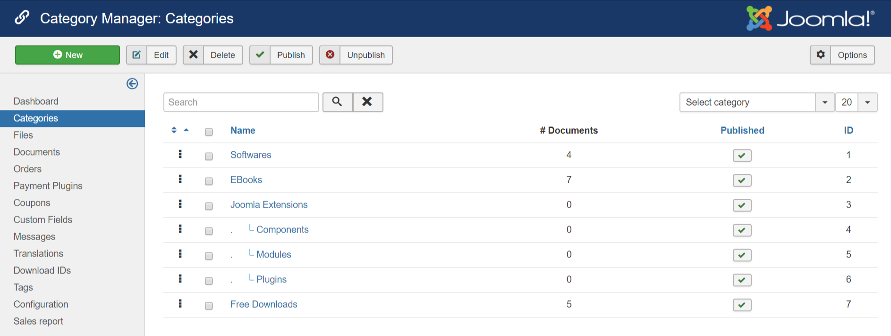
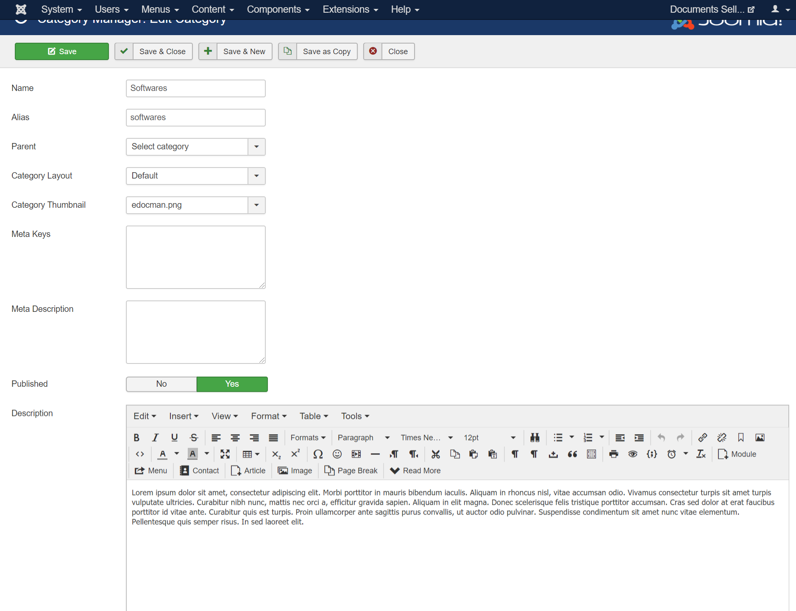

The next step would be setup **Categories**. **DMS** allows you to organize your documents cross infinite categories and subcategories (nested categories).

Access to **Documents Seller** -> **Categories** to access to categories management page and setup categories you want.

## Add new category
Press **New** button in the toolbar to create new category. A form will be displayed to allow you to enter information of the category:

<table class="table table-stripped table-bordered table-considered">
<thead>
<tr><th width="15%">Property</th><th>Description</th></tr>
</thead>
<tbody>
<tr>
<td><strong>Name</strong></td>
<td>Name of the category</td>
</tr>
<tr>
<td><strong>Parent</strong></td>
<td>Select parent of this category. Set it to <strong>Select Category</strong> and it will become top level category.</td>
</tr>
<tr>
<td><strong>Category Layout</strong></td>
<td>Choose the layout you want to use to display documents from this category. As of right now, there are 3 supported layouts: **Default**, **Columns** and **Table**.</td>
</tr>    
<tr>
<td><strong>Managers</strong></td>
<td>If you want to give some users permission to manage tickets submitted to this category, enter username of the manager(s) into this parameter. If a category has multiple managers, simply enter their username into this field (comma separatd, for example admin,tuanpn).</td>
</tr>
<tr>
<td><strong>Description</strong></td>
<td>Description of the category. It will be displayed on **Categories List** menu otpion.</td>
</tr>
</tbody>
</table>