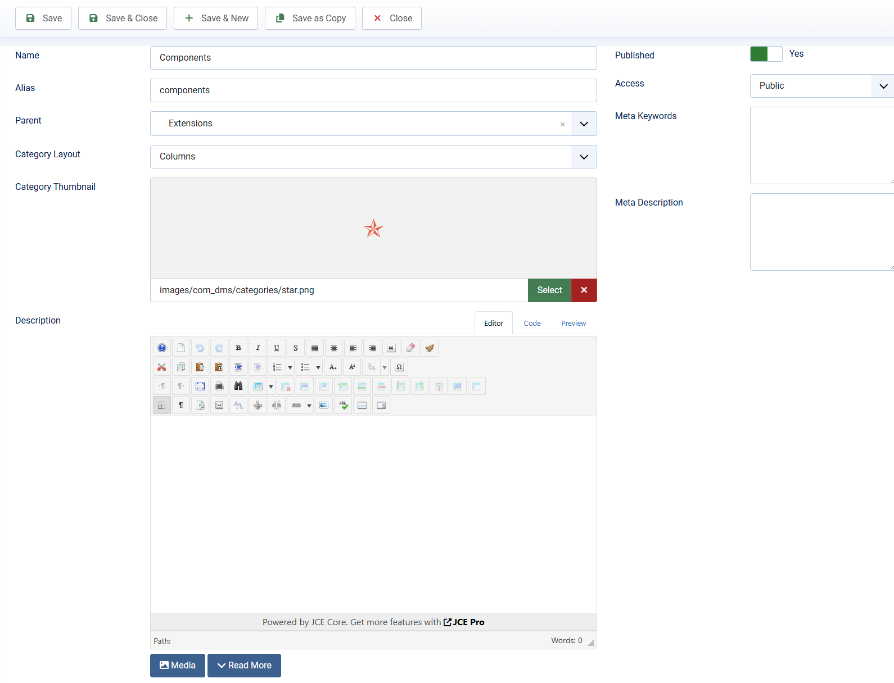
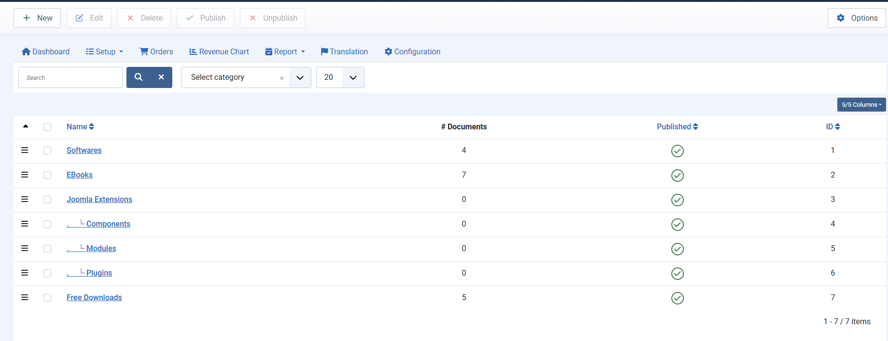

Categories organize your digital downloads so customers can browse your catalog by product type or topic. For example, you can create a top-level **Templates** category with **Business Templates** and **Design Templates** as subcategories. In Documents Seller, each downloadable product is a document, and you can assign the same document to more than one category.

## Create a category

1. In the Joomla administrator, go to **Documents Seller → Categories** and click **New**.
2. Enter a **Name**. Leave **Parent** set to **Select category** to create a top-level category, or choose an existing published category to create a subcategory.
3. Review the settings below and click **Save & Close**. Create and publish parent categories before adding their subcategories.

| Setting | How to use it |
| --- | --- |
| **Alias** | Leave this blank to generate a URL-friendly alias from the category name. |
| **Category Layout** | Choose how the category page displays its documents. **Default** shows a list, **Columns** arranges documents in columns, **Table** puts documents in table rows, and **Grid** displays them as cards. Menu items can choose their own layout. |
| **Category Thumbnail** | Select an image for the category. If **Resize Category Image** is enabled, Documents Seller generates a thumbnail when you save. |
| **Description** | Add a short introduction that tells customers what they can find in this category. It appears on the category page. |
| **Published** | Set to **Yes** so the category can appear in storefront category lists. |
| **Access** | Choose the Joomla viewing access level required to see this category in storefront category lists. Use **Public** to let guests see it. Documents have their own **Access** setting. |
| **Meta Keywords** and **Meta Description** | Optionally set metadata for the category page. |

## Add documents and link to categories

When you create or edit a [document](/setup/documents), select one or more published categories in the **Category** field. To also show documents from published subcategories on a parent category's page, enable **Show Documents From Children Categories** under **Documents Seller → Configuration → General**. See [Storefront Display and URLs](/getting-started/configuration/storefront-display-and-urls) for related display settings.

- Use a [Categories List](/frontend-menu-options/categories-list) menu item to let customers browse top-level categories or the immediate subcategories of a selected parent. Set its **Category Layout** to **Use Category Setup** to use each category's layout when customers click through. Choosing a layout in the menu item applies that layout to the category pages reached from it.
- To link straight to a category's documents, create a menu item of type **Category Default Layout**, **Category Column Layout**, **Category Table Layout**, or **Category Grid Layout**, and select the category in the menu item. The menu item type determines the layout for that page. See [Frontend Menu Options](/frontend-menu-options) for setup details.

## Manage categories

On **Documents Seller → Categories**, click a category name to edit it, or use the parent filter to find a category's immediate subcategories. Select categories to publish or unpublish them from the toolbar.

Deleting a category removes its document assignments. Before deleting it, reassign any documents that depend on it and choose a new **Parent** for any subcategories you want to keep in the catalog.
