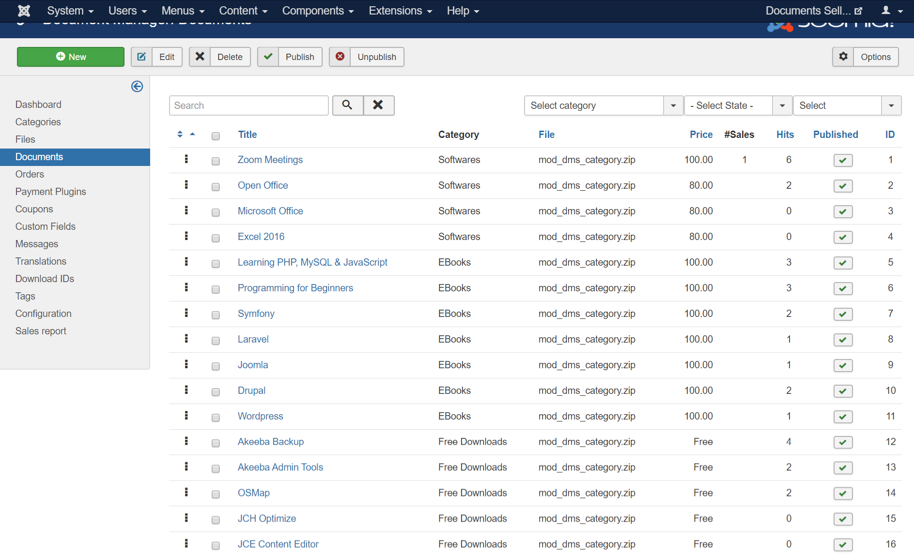
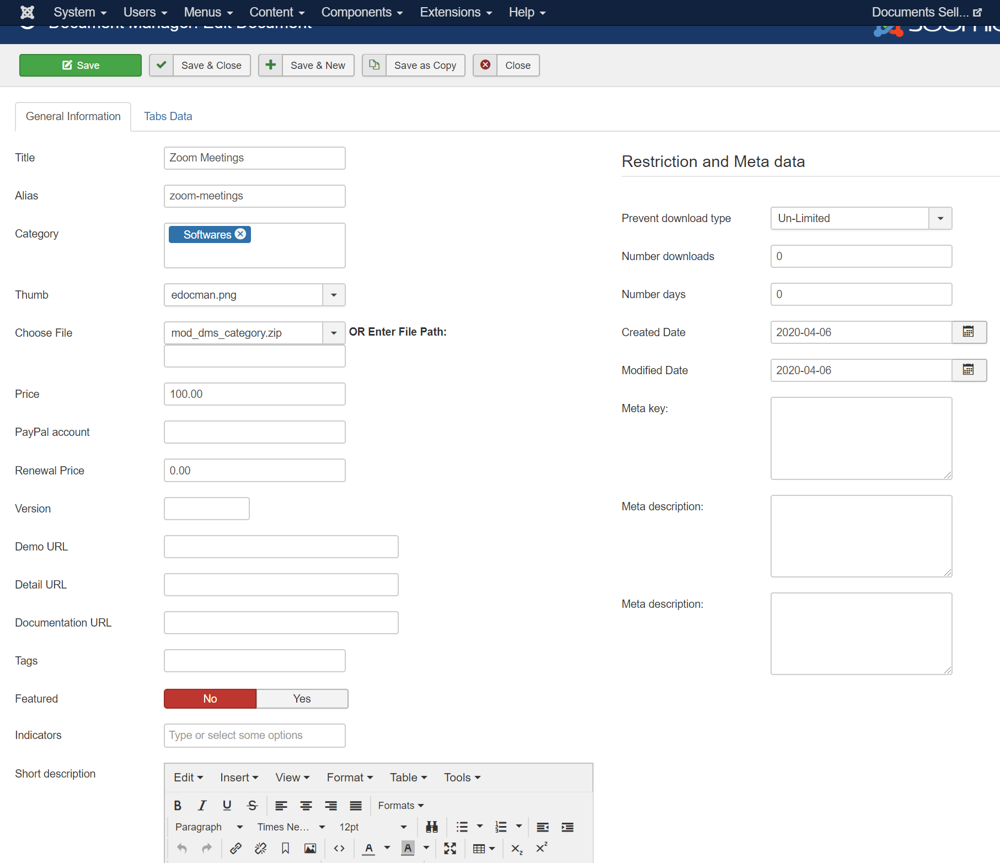

After setting up categories, the next step would be setup documents. Each document usually associated to a file which you upload on Files Management page. In case you want a document has multiple files (for example, when you sell one EBook with multiple file format), you need to zip these files into a single zip file and select that zip file for the document.

Go to **Documents Seller** -> **Documents** to access to Documents Management page. From there, you can add new document, publish, unpublish, delete, change ordering of existing documents.

## Add New Document
Press New button in the toolbar to create new document. A form will be displayed to allow you to enter information of the new document:

## General Information
<table class="table table-stripped table-bordered table-considered">
<thead>
<tr><th width="15%">Property</th><th>Description</th></tr>
</thead>
<tbody>
<tr>
<td><strong>Title</strong></td>
<td>Title of the document</td>
</tr>
<tr>
<td><strong>Category</strong></td>
<td>Select the categories of the document. A document needs to be assigned to at least one category.</td>
</tr><tr>
<td><strong>Choose File</strong></td>
<td>Choose the file associated to the document.</td>
</tr>    
<tr>
<td><strong>Price</strong></td>
<td>Enter price which users have to pay to purchase that document. If you leave it empty or set it to 0, the documents will be free for downloading.</td>
</tr>
<tr>
<td><strong>PayPal account</strong></td>
<td>If you use PayPal payment gateway to receive payment from your customers, and want to use a different PayPal account (with the PayPal account setup in os_paypal payment plugin) to receive payment for this document purchases, enter the PayPal account you want here. By default, it should be empty</td>
</tr>    
<tr>    
<td><strong>Short Description</strong></td>
<td>Shortdescription of the document. It will be displayed on the page which show list of documents.</td>
</tr>
<tr>    
<td><strong>Description</strong></td>
<td>Description of the document. It will be displayed on document details page.</td>
</tr>    
<tr>    
<td><strong>Prevent download type</strong></td>
<td>Choose how to limit customers from downloading the document after purchasing it. By default, it's limited. You can limit the download by Number Of Days (from order date) or by Number of Downloads if you want.</td>
</tr>      
<tr>    
<td><strong>Number Days</strong></td>
<td>If **Prevent download type** set to **Number Days**, you need to enter number days into this parameter and customers who purchased the document can only download it within X days from order date.</td>
</tr>
<tr>    
<td><strong>Number downloads</strong></td>
<td>If **Prevent download type** set to **Number Downloads**, you need to enter a number into this parameter and customers who purchased the document can only download it X times only (X is the entered Number).</td>
</tr>    
</tbody>
</table>

## Tabs Data
If you have many data to show documents to customers, you can enter these data into Tabs data tab of the document. **DMS** allows you to use up to 6 tabs to show document data (for each tab, you can setup tab title, and tab content)

- Tab1 Title
- Tab1 Data
- Tab2 Title
- Tab2 Data
- Tab3 Title
- Tab3 Data
- Tab4 Title
- Tab4 Data
- Tab5 Title
- Tab5 Data
- Tab6 Title
- Tab6 Data

