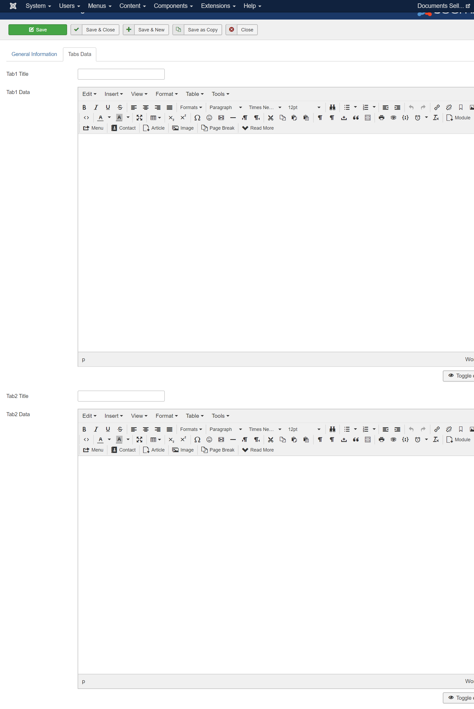

In Documents Seller, a document is a product listing for a digital download, such as an ebook, a template, or a software package. The document controls what customers see in your storefront, what they pay, and which file they receive. Categories organize the listings so customers can browse them.

Each document delivers one file. To offer several files as a single product, such as PDF and EPUB editions of an ebook, put them in a ZIP archive and use that archive as the download. Create separate documents if customers should be able to buy or download each edition individually.

## Create a document

1. [Upload the file](/setup/upload-files) you want customers to receive and create at least one published [category](/setup/categories) for the listing.
2. In the Joomla administrator, go to **Documents Seller → Documents** and click **New**.
3. On the **General Information** tab, enter a **Title** and select one or more published categories in **Category**. Leave **Alias** blank to generate it from the title for use in URLs.
4. Select the download in **Choose File**. If the file is missing from the list, check that it is in the top level of **Documents Path** and that its extension is included in **Allowed File Types**. To use a file in a subfolder under **Documents Path**, enter its relative path in **OR Enter File Path**, for example `ebooks/guide.pdf`. An entry in this field takes precedence over **Choose File**.
5. Enter a **Price** in your store currency. Use `0` for a free download. Configure [payment plugins](/setup/payment-plugins) for paid products or review the [free download settings](/getting-started/configuration/files-downloads-and-emails) to decide whether visitors must sign in or complete a form.
6. Set **Published** to **Yes** and choose the Joomla viewing access level in **Access**. Use **Public** if guests should be able to see the listing in your catalog. [Purchase access](/getting-started/configuration/checkout-and-accounts) and free download access are configured separately.
7. Click **Save & Close**. Open the document on your site from its category or through a [Document Detail](/frontend-menu-options/document-detail) menu item, then check the order or download flow as a customer.

## Describe the product

| Setting | How to use it |
| --- | --- |
| **Short Description** | Write a brief summary for storefront layouts that show a description in the product list. |
| **Description** | Explain what customers receive on the document detail page. Include details such as file formats, requirements, or licensing terms where relevant. |
| **Image** | Select a cover or preview image. If **Resize Document Image** is enabled, Documents Seller generates a thumbnail when you save. |
| **Featured** and **Indicators** | Mark a product as featured or add **New** and **Hot** labels in supported layouts. |
| **Tags** | Enter comma-separated tags to group related products by keyword. |
| **Meta Keywords** and **Meta Description** | Optionally set metadata for the document detail page under **Restriction and Meta data**. |

Use **Tabs Data** to organize additional information on the detail page, such as a table of contents, system requirements, or a changelog. Fill in **Tab1 Title** and **Tab1 Data** first, then add up to five more tabs. Each tab needs both a title and content to appear.

## Limit downloads after purchase

Under **Restriction and Meta data**, choose a **Prevent Download Type**.

| Option | How it works |
| --- | --- |
| **Un-Limited** | Applies no per-document download limit. |
| **After X downloads** | Set **Number Downloads** to the maximum number of times the customer can download the document for that order. Downloads from the email link and Orders History count toward the same limit. |
| **After X days** | Set **Number Days** to the number of calendar days customers have to download the file after the order is paid or approved. |

If **Download Link Valid In** is also set, emailed download links must meet both that expiration and the document's own limit. Use download links or [Orders History](/frontend-menu-options/orders-history) to enforce limits on access to the file. For email delivery, disable **Send Documents Via Email** to avoid sending a separate copy as an attachment. See [Files, Downloads, and Emails](/getting-started/configuration/files-downloads-and-emails).

## Set product-specific checkout options

These fields appear when **Activate Cart Feature** is disabled and customers order one document at a time.

- **Payment Methods** limits checkout to the published payment methods you select. Leave it empty to offer all published methods.
- **PayPal Account** overrides the account configured in the **os_paypal** plugin for purchases of this document. Leave it empty to use the plugin's account.
- **Notification Emails** overrides the global recipients for administrator order notifications. Separate multiple addresses with commas.

## Offer member discounts

Under **Members Discount Setting**, use **Discount Type** to choose a percentage or a fixed amount in the store currency. Enter the value in **Discount Amounts**. Choose Joomla user groups in **Groups** to limit the discount to signed-in members of those groups, or leave **Groups** empty to offer the discount to all signed-in users. For different amounts per group, enter one comma-separated value per group in the order the groups appear after saving. Customers who belong to several selected groups receive the largest applicable discount.

## Offer a separate software update package

If you distribute software updates through Download IDs, place the update file in an `updates` subfolder under **Documents Path**. The **Update Package** field appears when that folder exists. Choose the package there and keep **Choose File** set to the standard customer download. If no update package is selected, Download ID requests serve the standard file.

## Manage documents

Go to **Documents Seller → Documents** to search for listings, filter by category or publication status, and open a document by clicking its title. Use the toolbar to publish, unpublish, or delete selected listings. To control the storefront sequence with the list's ordering controls, set the relevant storefront sort to **Ordering**.

If the **File** column shows **(File missing)** for a local download, restore the file to its original location or edit the document and assign a replacement. Clear **OR Enter File Path** if you switch to a file from **Choose File**. Changing the file also changes what eligible customers with existing orders receive.

To hide a product from category listings while keeping existing orders downloadable, unpublish the document. If you created a **Document Detail** menu item for the product, unpublish that menu item too. Deleting the document removes the record existing orders use to find the file.
