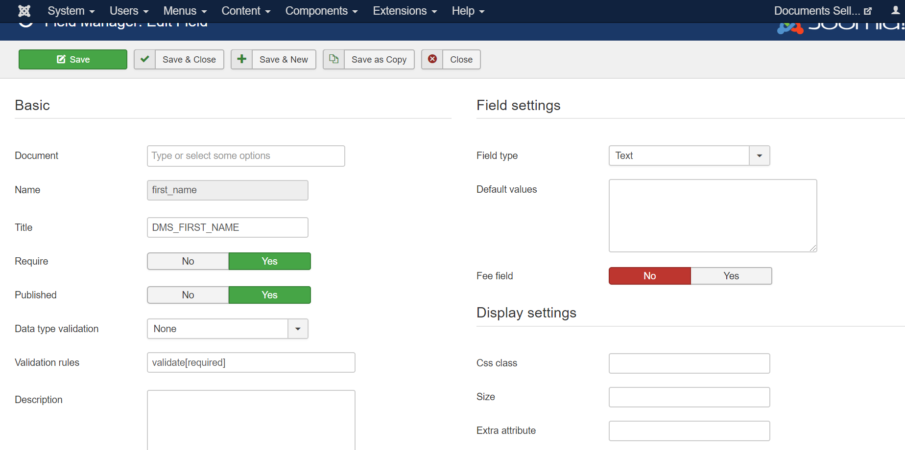

In the Joomla administrator, go to **Documents Seller → Custom Fields** and click **New**.

1. Enter a unique **Name**, such as `license_domain`. Use letters, numbers, and underscores. Enter the label customers should see in **Title**, such as **License Domain**.
2. Choose a [**Field type**](/setup/custom-fields/field-types). Add a **Description** if customers need help answering. For a **Message** field, enter the text to display in **Description**.
3. Set **Require** to **Yes** if customers must enter a value or select an option. To check its format or length, configure [**Data type validation** and **Validation rules**](/setup/custom-fields/validate-field-data-client-side).
4. Set **Published** to **Yes** and select an **Access** level. Choose **Public** if the field should appear for guests who can check out.
5. Set **Document** if the field applies to specific products. Configure any options, default values, or fees, then click **Save & Close**.
6. Open checkout as a customer who should see the field. Place a test order and open it under **Documents Seller → Orders** to check the saved answer.

## Choose which documents use the field

Leave **Document** empty to make the field available for all documents. To limit it to one or more products, select the published documents in **Document**.

When the order contains one document, checkout shows fields assigned to that document and fields available for all documents. When the cart contains multiple documents, checkout shows all published fields the customer can access, including fields assigned to documents outside the cart. If a question or fee must apply only to specific products, set **Activate Cart Feature** to **No** for single-document checkout. See [Checkout and Accounts](/getting-started/configuration/checkout-and-accounts).

## Configure options and defaults

| Setting | How to use it |
| --- | --- |
| **Values** | For **List**, **Checkboxes**, and **Radio**, enter one option per line in the order you want customers to see them. |
| **Multiple** | For **List**, choose **Yes** to let customers select more than one option. |
| **Default values** | Enter a starting value or the exact text of an option to preselect. For **Checkboxes** or a **List** with **Multiple** enabled, enter one default option per line. |
| **Fee field**, **Fee Values**, and **Fee formula** | Use these settings to [add a charge based on the customer's answer](/setup/custom-fields/custom-fee-fields). |

If **Fields mapping** is available, select the corresponding profile field to prefill this checkout field for signed-in customers using the configured integration.

## Adjust the display

Use **Rows** and **Cols** to set the initial dimensions of a **Textarea**. Use **Size** to set a **Text** field's input width or the number of **Radio** options per row. Use **Css class** to style the field. The standard checkout currently omits attributes entered in **Extra attribute**.
