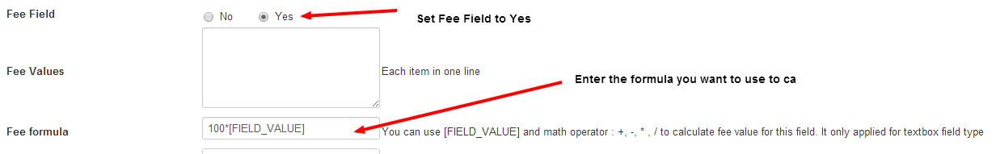

Set **Fee field** to **Yes** to charge customers for a selection or an amount they enter at checkout. Use **List**, **Checkboxes**, or **Radio** for priced options and **Text** for numeric input. Documents Seller adds the fees from all enabled fee fields to the order subtotal before applying any coupon discount, tax, or payment processing fee.

## Charge for one selected option

For example, offer priority support with a software download.

| Setting | Value |
| --- | --- |
| **Title** | Priority Support |
| **Field type** | **Radio**, or **List** with **Multiple** set to **No** |
| **Default values** | `No` |
| **Fee field** | **Yes** |
| **Fee formula** | Leave blank. |

Enter these options in **Values**, one per line.

```text
Yes (+$20)
No
```

Enter their prices in **Fee Values** in the same order, one amount per line.

```text
20
0
```

The first amount applies to the first option, and the second applies to the second. **Yes (+$20)** adds $20 to the order. **No** adds $0. Use your store currency and enter plain numbers in **Fee Values**, such as `20` or `9.50`. If you reorder the options, reorder their prices as well.

## Charge for multiple selected options

Use **Checkboxes** or a **List** with **Multiple** set to **Yes**. Enter each option and its corresponding fee on the same line number in **Values** and **Fee Values**. Leave **Fee formula** blank. If customers select two add-ons priced at $10 and $15, Documents Seller adds $25 to the order.

## Charge an amount entered by the customer

To let customers add an optional contribution to an order, create a field with the following settings.

| Setting | Value |
| --- | --- |
| **Name** | `donation_amount` |
| **Title** | Donation Amount |
| **Field type** | **Text** |
| **Require** | **No** |
| **Data type validation** | **Number** |
| **Validation rules** | `validate[custom[number],min[0]]` |
| **Fee field** | **Yes** |
| **Fee formula** | `[FIELD_VALUE]` |

A customer who enters `10` adds $10 to the order. A blank field adds $0. The validation rule gives customers feedback in the browser when they enter a negative amount or text.



## Calculate a fee with a formula

**Fee formula** is required for **Text** fee fields. For **List**, **Checkboxes**, and **Radio**, a formula replaces the automatic option fee. Use numbers, parentheses, and the arithmetic operators `+`, `-`, `*`, and `/`.

| Placeholder | Value used in the calculation |
| --- | --- |
| `[FIELD_VALUE]` | The number entered in the current **Text** field. |
| `[FIELD_NAME_IN_UPPERCASE]` | The value of a named checkout field, using its **Name** in uppercase. A **Text** field provides the number entered, **Radio** and single-selection **List** fields provide the selected option's fee, and **Checkboxes** and multiple-selection **List** fields provide the sum of the selected options' fees. |
| `[ITEM_PRICE]` | The price of the first document returned by the cart, after any member discount and before coupon discounts and tax. For a percentage based on a particular document's price, use this placeholder in single-document checkout. |

For a formula on a choice field, use its uppercase name to read its own selected option fees. For example, the formula `[SUPPORT_OPTION] * [SUPPORT_MONTHS]` on a **Radio** field named `support_option` multiplies the selected monthly fee by the number entered in a **Text** field named `support_months`. On `support_option`, set **Fee field** to **Yes** and enter the monthly rates in **Fee Values**. Leave **Fee field** set to **No** on `support_months` so the number of months is used only in the formula. With a $15 option and two months, the added fee is $30.

Keep fields referenced by a formula available on the same checkout form. Test the total with the default values, with different selections, and with optional fields left blank.
