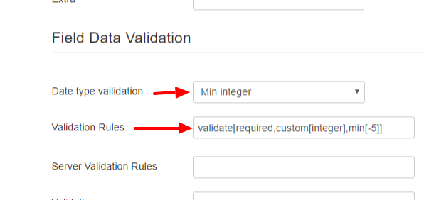

Documents Seller uses [jQuery Validation Engine](http://posabsolute.github.io/jQuery-Validation-Engine/) to check field values in the customer's browser. If an answer fails a configured rule, checkout displays a message so the customer can correct it.

## Set up validation

1. In the Joomla administrator, go to **Documents Seller → Custom Fields** and edit the field.
2. Set **Require** to **Yes** if the customer must answer. For a **Text** field, choose a preset under **Data type validation** if you need a specific format, such as **Integer Number**, **Number**, or **Email**.
3. Review the generated **Validation rules**. Some presets start with example limits. For instance, **Min integer** generates `custom[integer],min[-5]` within the rule. Replace `-5` with the minimum you want.
4. If you need a custom rule, enter it in **Validation rules** after choosing **Require** and **Data type validation**. The editor regenerates the rules when you open the field or change either setting, so check the rule before saving.
5. Click **Save & Close**, then test checkout with a valid value, an invalid value, and a blank answer.

| Validation rule | What it checks |
| --- | --- |
| `validate[required,custom[email]]` | The customer must enter a valid email address. |
| `validate[required,custom[integer],min[10]]` | The customer must enter a whole number of 10 or more. |
| `validate[custom[number],min[0]]` | The field is optional. If filled in, it must contain a number of zero or more. |

See the [jQuery Validation Engine validators](http://posabsolute.github.io/jQuery-Validation-Engine/#validators) for additional rules.

