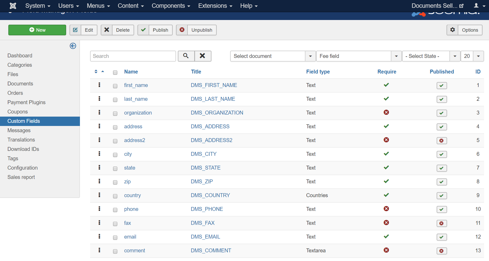

**Custom fields** are the fields which are being displayed on order form to allow collect customers information when they purchase documents on your site via **Documents Seller**.

When you first install Documents Seller, the extension following custom fields (which is called **core fields**) : **First Name**, **Last Name**, **Organization**, **Address**, **Address2**, **City**, **State**, **Zip**, **Country**, **Phone**, **Fax**, **Email**, **Comment**

Go to **Documents Seller** -> **Custom Fields** to access to custom fields management page.

Since custom fields are being displayed on order form, you usually need to do the following tasks related to custom fields:
1. **Change title of the field**. In this case, just edit the custom field, change the title to meet your need and save it.
2. **Show / Hide** some of the existing custom fields on subscription form. In that case, just **Publish / Unpublish** the field you want.
2. **Make some fields become required / optional**. If so, just edit the custom field, set **Require** property to **Yes / No**.
3. **Add new custom fields**. In that case, just press New button in the toolbar to add new field.
4. **Change ordering of the custom fields**. In that case, just drag & drop the field to the postion you want (same with Joomla core)