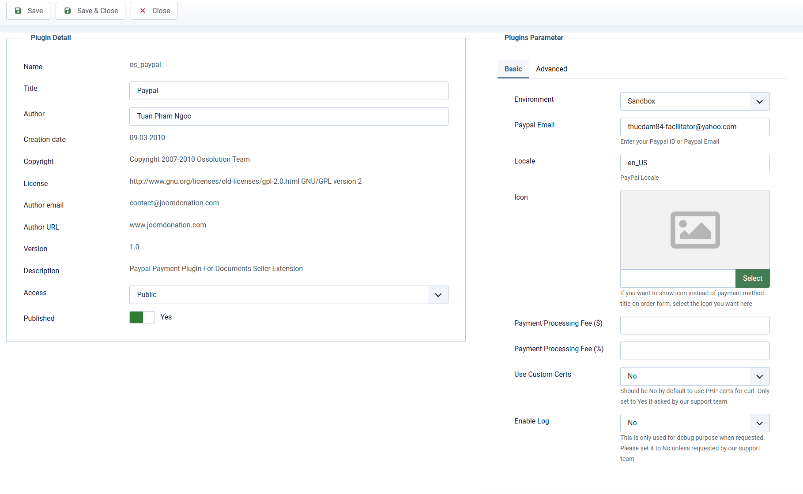
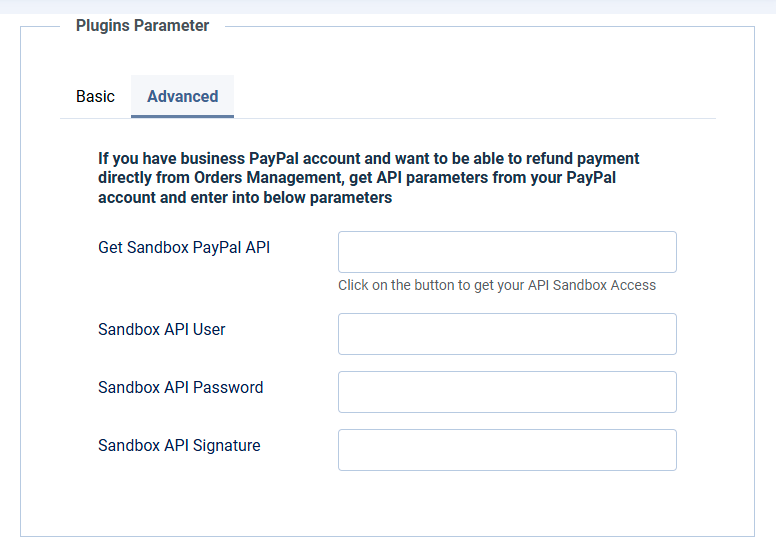

The PayPal Payments Standard plugin sends customers to PayPal to pay for their order. Go to **Documents Seller → Payment Plugins** and open **os_paypal**.

## Basic settings

| Setting | How to configure it |
| --- | --- |
| **Environment** | Select **Sandbox** for test payments or **Live** to accept real payments. |
| **Paypal Email** | Enter the PayPal account email address or ID that should receive the payment. Use your sandbox business account in **Sandbox**. |
| **Locale** | Sets the language and regional format requested for PayPal checkout, such as `en_US`. If the field is blank, the plugin uses the active Joomla language on multilingual sites and `en_US` on other sites. |

See [shared settings](/setup/payment-plugins#set-an-icon-or-a-processing-fee) for the icon and processing fee fields. Leave **Use Custom Certs** and **Enable Log** set to **No** unless support asks you to change them.

If the cart is disabled, a document's **PayPal Account** setting can override the receiving account for that document. See [Documents](/setup/documents#set-product-specific-checkout-options).

## Enable refunds from Orders

The plugin uses the PayPal REST API to process refunds. On the **Advanced** tab, enter both credentials for the selected **Environment** if you want to issue refunds from **Documents Seller → Orders**. These fields are optional for accepting payments.

| Environment | Fields |
| --- | --- |
| **Live** | **Client ID** and **Client Secret** |
| **Sandbox** | **Sandbox Client ID** and **Sandbox Client Secret** |

Only the fields for the selected environment are displayed. Use credentials belonging to the PayPal business account that received the payment. This also applies if a document's **PayPal Account** setting overrides the plugin's receiving account.

If you previously configured **API User**, **API Password**, and **API Signature**, replace them with the REST API credentials below to continue issuing refunds from Orders.

### Get your Client ID and Client Secret

1. Open the [PayPal Developer Dashboard](https://developer.paypal.com/dashboard/) and sign in with your PayPal business account.
2. Go to **Apps & Credentials** and select **Live** for real payments or **Sandbox** for testing.
3. Open an existing REST API app, or click **Create App** and follow the prompts to create one. For sandbox testing, use an app associated with the sandbox business account that receives your test payments.
4. Copy the app's **Client ID** and reveal and copy its **Client Secret**.
5. Return to **Documents Seller → Payment Plugins → os_paypal**. Set **Environment** to the same environment selected in PayPal, open the **Advanced** tab, and paste the credentials into the matching fields shown in the table above.
6. Click **Save**.

See PayPal's [Get your client ID and client secret](https://developer.paypal.com/api/get-started/#1-get-your-client-id-and-client-secret) guide for more information. Keep the **Client Secret** private.

Sandbox and live credentials are different. When switching to **Live**, enter your live credentials before issuing refunds for real payments.

### Issue a refund

Open a paid PayPal order under **Documents Seller → Orders**, click **Refund**, and confirm. The plugin requests a full refund of the original PayPal transaction. See [Refund an order](/orders-management#refund-an-order) for the permissions, order requirements, and what happens after a refund.

If PayPal rejects the request, check that both credentials are correct, match the selected environment, and belong to the account that received the payment. Check the transaction in PayPal before retrying a refund.
