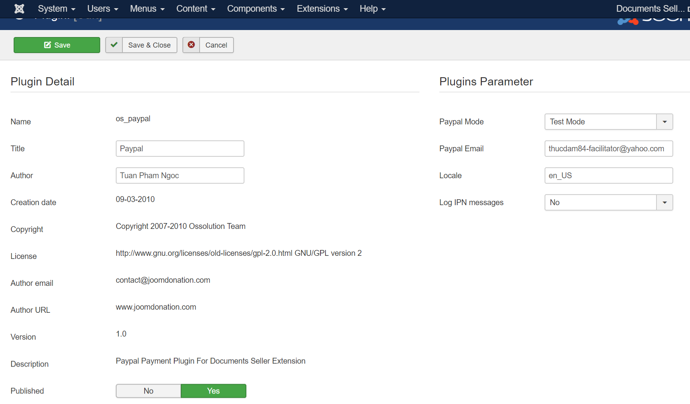
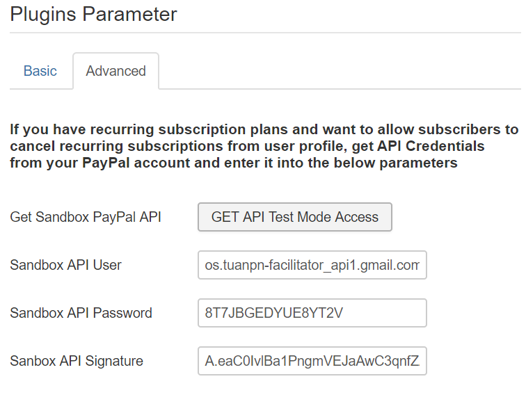

The PayPal Payments Standard plugin sends customers to PayPal to pay for their order. Go to **Documents Seller → Payment Plugins** and open **os_paypal**.

## Basic settings

| Setting | How to configure it |
| --- | --- |
| **Environment** | Select **Sandbox** for test payments or **Live** to accept real payments. |
| **Paypal Email** | Enter the PayPal account email address or ID that should receive the payment. Use your sandbox business account in **Sandbox**. |
| **Locale** | Sets the language and regional format requested for PayPal checkout, such as `en_US`. If the field is blank, the plugin uses the active Joomla language on multilingual sites and `en_US` on other sites. |

See [shared settings](/setup/payment-plugins#set-an-icon-or-a-processing-fee) for the icon and processing fee fields. Leave **Use Custom Certs** and **Enable Log** set to **No** unless support asks you to change them.

If the cart is disabled, a document's **PayPal Account** setting can override the receiving account for that document. See [Documents](/setup/documents#set-product-specific-checkout-options).

## Enable refunds from Orders

On the **Advanced** tab, enter the corresponding API credentials if you want to issue refunds from **Documents Seller → Orders**. These fields are optional for accepting payments.

| Environment | Fields |
| --- | --- |
| **Live** | **API User**, **API Password**, and **API Signature** |
| **Sandbox** | **Sandbox API User**, **Sandbox API Password**, and **Sandbox API Signature** |

Use the credentials for your PayPal business account in the selected environment. The tab provides **Get PayPal API** or **Get Sandbox PayPal API** according to the selected environment.

