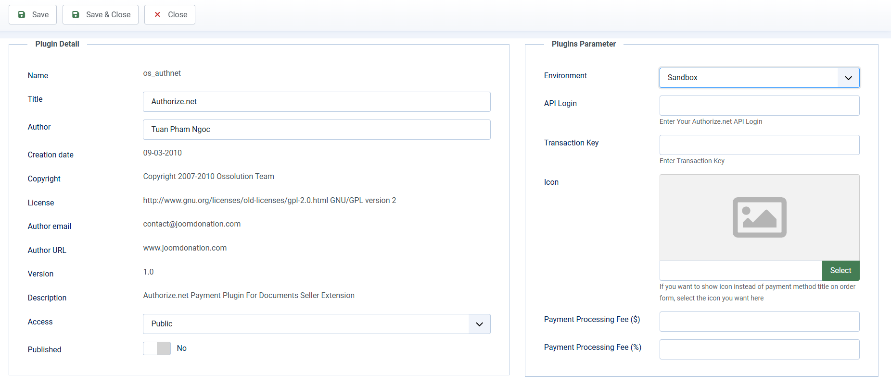

The Authorize.Net AIM plugin accepts card details on the Documents Seller checkout form. Go to **Documents Seller → Payment Plugins** and open **os_authnet**.

| Setting | How to configure it |
| --- | --- |
| **Environment** | Select **Sandbox** for test payments or **Live** to accept real payments. |
| **API Login** | Enter the API Login ID for your Authorize.Net account in the selected environment. |
| **Transaction Key** | Enter the transaction key that belongs to that API Login ID. |

Use credentials from your own sandbox account when testing. When you switch to **Live**, enter your live account's **API Login** and **Transaction Key**.

The same credentials allow you to issue refunds from **Documents Seller → Orders**. See [shared settings](/setup/payment-plugins#set-an-icon-or-a-processing-fee) for the icon and processing fee fields.
