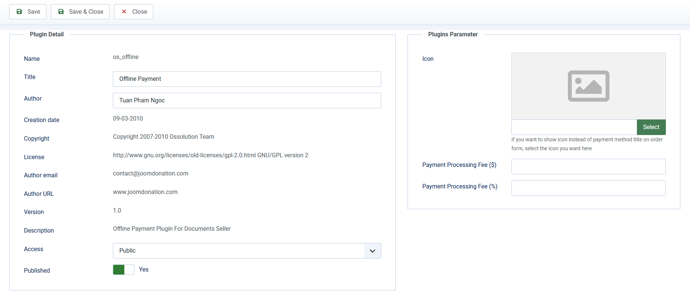

Use the **Offline Payment** plugin to accept payments outside checkout, such as bank transfers or cash. Documents Seller records the order as **Pending**. You mark it as **Paid** after you receive the payment, which gives the customer access to the purchased downloads.

## Set up offline payments

1. Go to **Documents Seller → Payment Plugins** and open **os_offline**.
2. Set **Title** to the payment method you accept, such as **Bank Transfer**, then save. The plugin also supports the [shared icon and processing fee settings](/setup/payment-plugins#set-an-icon-or-a-processing-fee).
3. Go to **Documents Seller → Messages** and update the templates below. Include the details customers need to pay, such as your bank details and the reference to include with the transfer.
4. Return to **Payment Plugins**, set **Published** to **Yes** for **os_offline**, and save.

| Message fields | When Documents Seller uses them |
| --- | --- |
| **Thank You Message (Offline Payment)** | On the order completion page after the customer submits an offline order. |
| **Offline payment Email Subject** and **Offline payment Email Body** | In the email sent to the customer after they submit the order. Include the payment instructions here so they can refer to them later. |
| **Order Approved Email Subject** and **Order Approved Email Body** | In the email sent to the customer after you approve the order. |

## Approve an order after receiving payment

1. Go to **Documents Seller → Orders** and open the pending order.
2. Change **Order Status** from **Pending** to **Paid**, then save the order. You can also [publish the order from the Orders list](/orders-management).
3. Documents Seller sends the order approval email. If **Send Documents Via Email** is enabled, it attaches the purchased files. Customers with an account can also download them through a published [Orders History](/frontend-menu-options/orders-history) menu item.

