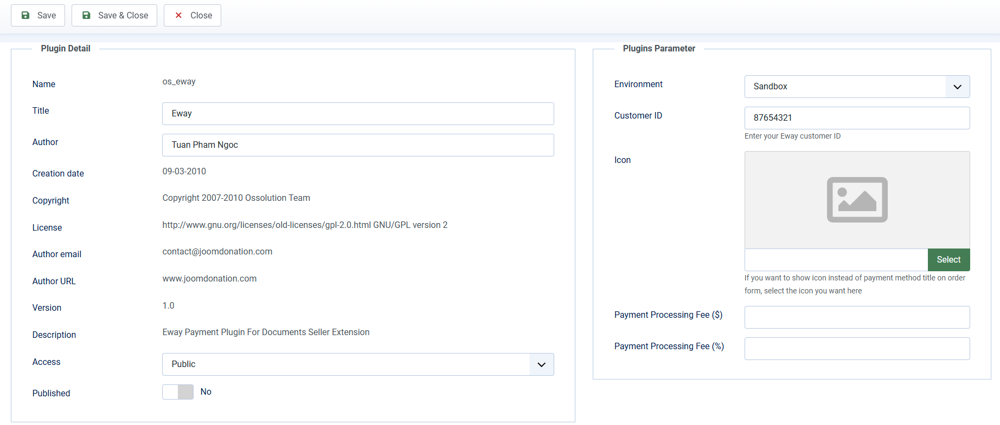

The Eway plugin uses the Eway Direct integration. Go to **Documents Seller → Payment Plugins** and open **os_eway**.

| Setting | How to configure it |
| --- | --- |
| **Environment** | Select **Sandbox** for test payments or **Live** to accept real payments. |
| **Customer ID** | Enter your Eway Customer ID for the selected environment. Replace the prefilled value with your own Customer ID before going live. |

See [shared settings](/setup/payment-plugins#set-an-icon-or-a-processing-fee) for the icon and processing fee fields. Save and publish the plugin when it is ready for checkout.