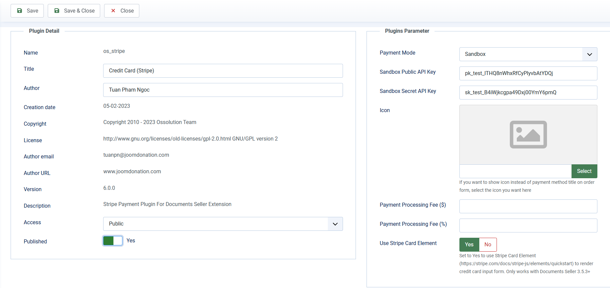

## Installation

Install the purchased `os_dms_stripe.zip` package from **Documents Seller → Payment Plugins**. See [Install New Payment Plugin](/setup/payment-plugins#install-new-payment-plugin).

## Configuration

Open the plugin and enter the API keys from your Stripe account, then save and publish the plugin. See the [Stripe API keys documentation](https://stripe.com/docs/keys#api-keys).

