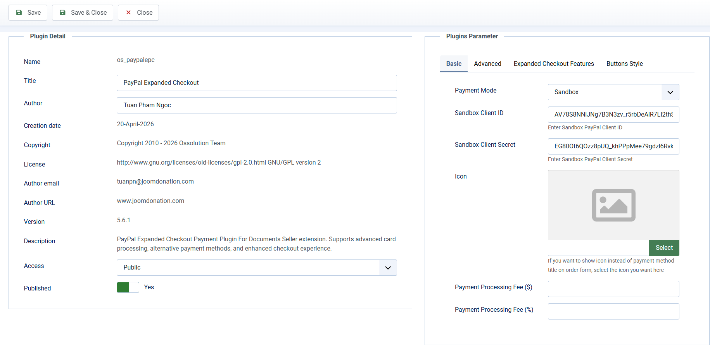

## Installation

After purchasing the plugin, install `os_dms_paypalepc.zip` from **Documents Seller → Payment Plugins**. See [Install New Payment Plugin](/setup/payment-plugins#install-new-payment-plugin).

## Configuration

- Follow instructions at [https://developer.paypal.com/api/rest/#link-getclientidandclientsecret](https://developer.paypal.com/api/rest/#link-getclientidandclientsecret) , get **Client ID** and **Client Secret** of your PayPal account
- Go to **Documents Seller -> Payment Plugins**, click on os_paypalepc payment plugin to edit, enter necessary parameters there.
- If you want to change the message displayed on payment screen, please go to **Documents Seller** -> **Translation**, find the language item **DMS_PAYPAL_EPC_PAYMENT_INSTRUCTIONS** and change it. If the language item is missing, just add it.

## Joomla 4, Joomla 5, Joomla 6 Note

If you are using Joomla 4.0+, it has a plugin called **System - HTTP Headers** . By default, that plugin will prevent the popup window to allow users to pay using their PayPal account. To prevent that issue, you will need to edit the plugin, change the **Cross-Origin-Opener-Policy** parameter to **same-origin-allow-popups** and it will work well

