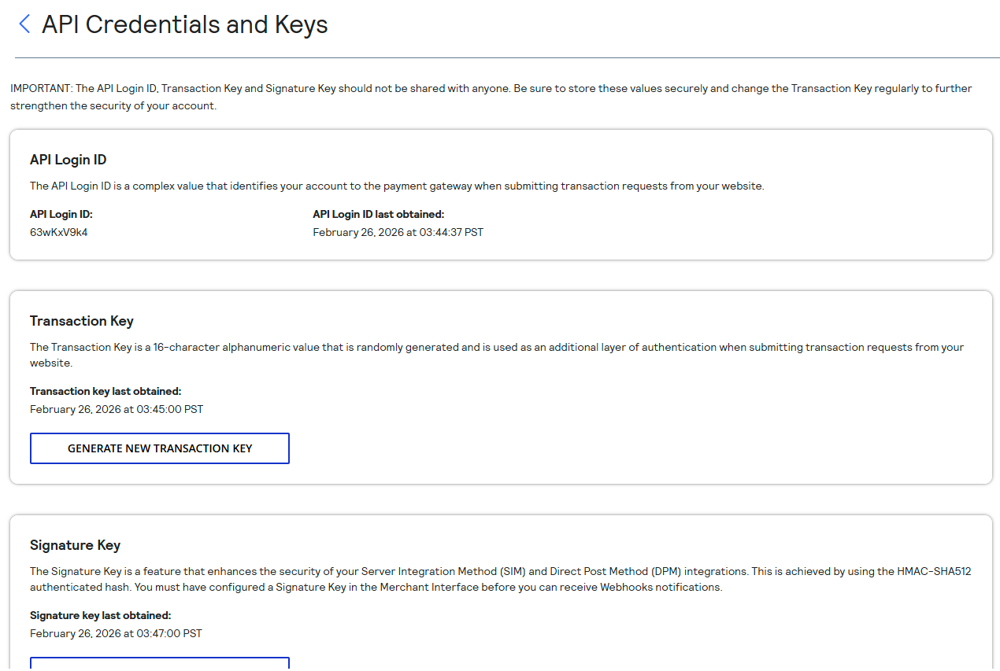
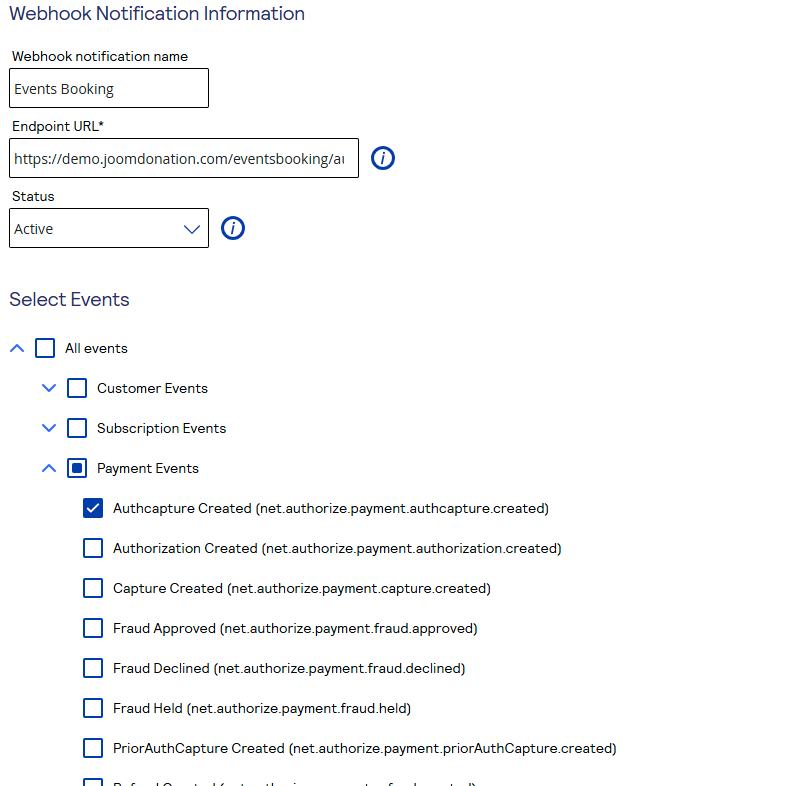

## Installation

Extract `os_dms_authnetaccepthosted_unzip_first.zip` to find the plugin package and three PHP files.

1. Install `os_dms_authnetaccepthosted.zip` from **Documents Seller → Payment Plugins**. See [Install New Payment Plugin](/setup/payment-plugins#install-new-payment-plugin).
2. Upload `authaccepthosted_dms_cancel.php`, `authaccepthosted_dms_return.php`, and `authaccepthosted_dms_webhook.php` to your site's root folder.
3. If you use the Admin Tools Pro .htaccess Maker, add the three files under **Exceptions from Server Protection** and regenerate the `.htaccess` file so the files are accessible.

## Configuration

1. Sign in to your Authorize.Net account and go to **Account → Account and API Settings → API Credentials and Keys**. Get your **API Login**, **Transaction Key**, and **Signature Key**, generating the keys if needed.
2. Open the **os_authnetaccepthosted** plugin and enter the credentials in the corresponding fields.

   

3. In your Authorize.Net account, go to **Account → Account and API Settings → API Credentials and Keys → Webhooks** and create a webhook. Use the URL below, replacing `https://yourdomain.com` with your site URL.

   ```text
   https://yourdomain.com/authaccepthosted_eb_webhook.php
   ```

4. Select **Authcapture Created** (`net.authorize.payment.authcapture.created`) for the webhook.

   
