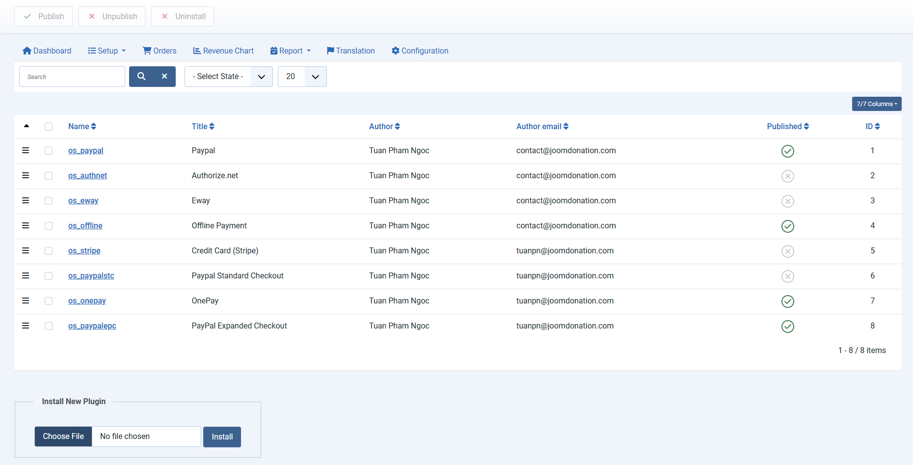
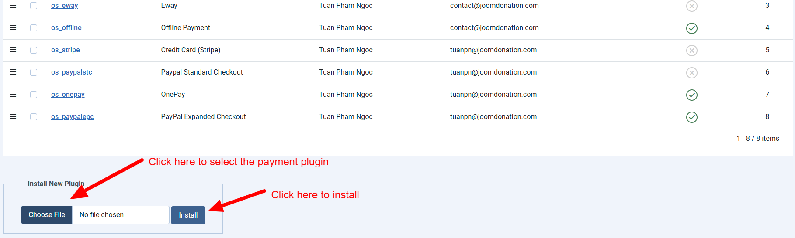

Payment plugins determine how customers pay for digital downloads. Publish the methods you want to offer at checkout. An online gateway can confirm payment automatically. With Offline Payment, you approve the order after receiving the money, which releases the downloads.

Go to **Documents Seller → Payment Plugins** in the Joomla administrator to manage these plugins.

## Choose a payment plugin

Documents Seller includes four payment plugins. Open the setup guide for the method you want to offer.

| Plugin | When to use it |
| --- | --- |
| [PayPal](/setup/payment-plugins/paypal) (`os_paypal`) | Send customers to PayPal to pay through PayPal Payments Standard. |
| [Authorize.Net](/setup/payment-plugins/authorize-net) (`os_authnet`) | Accept card payments through the Authorize.Net AIM integration. |
| [Offline Payment](/setup/payment-plugins/offline-payment) (`os_offline`) | Accept bank transfers, cash, or other payments that you confirm manually. |
| [Eway](/setup/payment-plugins/eway) (`os_eway`) | Accept card payments through the Eway Direct integration. |

Setup guides are also available for [PayPal Pro](/setup/payment-plugins/paypal-pro), [Stripe](/setup/payment-plugins/stripe), [Stripe Checkout](/setup/payment-plugins/stripe-checkout), [Worldpay](/setup/payment-plugins/worldpay), and [Authorize.Net Accept Hosted](/setup/payment-plugins/authorize-net-accept-hosted). Browse the [Documents Seller payment plugin catalog](https://joomdonation.com/payment-plugins/documents-seller-payment-plugins.html) for available add-ons.

## Install New Payment Plugin

1. Go to **Documents Seller → Payment Plugins**.
2. Scroll to **Install New Plugin** at the bottom of the page.
3. Click **Choose File** and select the installable ZIP package. If your download contains a separate plugin ZIP, extract the outer archive first and select the plugin ZIP.
4. Click **Install**.

New plugins start unpublished. Open the plugin by clicking its **Name**, configure it, and publish it when it is ready for checkout.

## Configure a payment method

1. On **Payment Plugins**, click the plugin's **Name** to open it.
2. Set **Title** to the label customers should see at checkout, such as **Bank Transfer** for an offline method.
3. Set **Access** to the Joomla viewing access level for customers who should see this method. Use **Public** to make it available to guests when guest checkout is allowed.
4. Enter the plugin-specific settings, set **Published** to **Yes**, and click **Save**.

When the cart is disabled, a document's **Payment Methods** setting can further limit the checkout options. See [Set product-specific checkout options](/setup/documents#set-product-specific-checkout-options).

## Duplicate a payment plugin

Duplicate a plugin when you need more than one payment method using the same gateway, each with its own settings. For example, you can offer two bank transfer options with different payment instructions, or use different gateway accounts for different documents.

### Duplicate from the payment plugins list

1. Go to **Documents Seller → Payment Plugins**.
2. Select the checkbox next to the plugin you want to copy. You can select several plugins to create one copy of each.
3. Click **Duplicate** in the toolbar.
4. The page returns to the payment plugins list. Open the new copy to configure it.

### Duplicate from the plugin details page

1. Open the payment plugin you want to copy.
2. If you have changed any settings that you want included in the copy, click **Save** first, then reopen the plugin. Duplication uses the saved settings; it does not save changes entered on the form.
3. Click **Duplicate** in the toolbar. The page returns to the payment plugins list.
4. Open the new copy to configure it.

### Configure the copy

The copy inherits the source plugin's settings, including its credentials, access level, icon, and processing fees. Documents Seller assigns it a unique **Name**, such as `os_paypal_1`, appends a number to its **Title**, and sets **Published** to **No**.

1. Change **Title** to a clear label customers can recognize at checkout.
2. Review the copied settings. Replace the gateway credentials or payment instructions if the new method should use a different account.
3. Set **Published** to **Yes** and click **Save** when the method is ready.

When the cart is disabled, you can assign the appropriate copy through each document's **Payment Methods** setting. See [Set product-specific checkout options](/setup/documents#set-product-specific-checkout-options).

Copies use the original plugin's files, so you do not need to copy or edit any code. To remove a copy, select it in **Payment Plugins** and click **Uninstall**. This removes only that copy. The original plugin cannot be uninstalled while copies still exist; remove its copies first.

## Set an icon or a processing fee

The bundled plugins share these settings.

| Setting | How it works |
| --- | --- |
| **Icon** | Displays the selected image in place of the payment method title at checkout. Leave it empty to display the title. |
| **Payment Processing Fee ($)** | Adds a fixed amount in the store currency. |
| **Payment Processing Fee (%)** | Adds a percentage of the order amount after discounts and tax, before the processing fee. |

If both fee fields are set, Documents Seller adds the fixed and percentage portions together. Fees apply to orders with a positive amount due.

## Publish or unpublish payment methods

Use the status icon in the **Published** column, or select one or more plugins and click **Publish** or **Unpublish** in the toolbar. Unpublish unused methods to hide them from checkout.

## Change the default payment method

Checkout preselects the first payment method available to the customer. Sort the **Payment Plugins** list by **Ordering** in ascending order and drag the preferred plugin above the other methods.

## Translate a payment method title

1. Edit the plugin and enter a language key such as `DMS_PAYMENT_BANK_TRANSFER` in **Title**. Save the plugin.
2. Go to **Documents Seller → Translation** and select **Frontend language** and `en-GB`. Click **New Item**, enter the key and its English label, then save.
3. Select each other language used at checkout. Find the same key, enter its translated label, and save.
