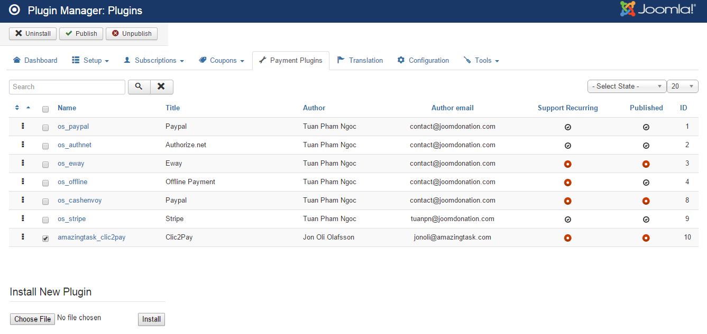
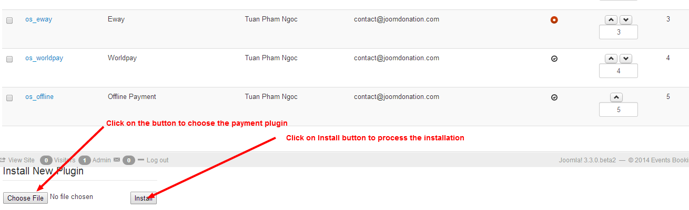

When customers purchase your documents, if the document is a paid document (price > 0), customers will have to make payemnt to be complete the order before they can download the purchased document.

In order to receiving online payment from your customers, you will need to config Documents Seller to use the payment plugins you want. When you install Documents Seller, there are 4 payment plugins installed with it by default: **Paypal** (Paypal payment standard), **Authorize.net (AIM)*, **Eway** and **Offline Payment**.

Go to Documents Seller -> Payment Plugins to access to payment plugins management page.

## Install New Payment Plugin

Sometime, you will need to use a payment plugin which doesn't come with Document Seller by default. In this case, you might have to purchase these payment plugins at [https://joomdonation.com/payment-plugins/documents-seller-payment-plugins.html](https://joomdonation.com/payment-plugins/documents-seller-payment-plugins.html)  (if it is available) or develop it yourself (or hire someone to develop it for you). Once you got the payment plugin, you will need to install it.  Please follow the step below to install a payment plugin:
1.  Go to **Documents Seller -> Payment Plugins**
2.  Scroll to bottom of the page.
3.  Click on Choose File button to browse for the payment plugin.
4.  Click on Install button to process the installation.

## Common Tasks

### Unpublish un-used payment plugins
It is very likely that you won't use all of the 4 payment plugins come with Documents Seller out of the box, so you will need to unpublish the one you don't want to use. There are two ways to unpublish a payment plugin:
1. Click on the **green (published) icon** in the Published column.
2. Check on the checkbox next to the payment plugin, then press **Unpublish** button in the toolbar.

### Change title of payment plugin

You might want to change the title of the payment plugin to make it easier to understand to your end users. For example, you might want to change the title from **Authorize.net** to **Creditcard**....

To change title of the payment plugin, please click on the payment plugin to edit, change the title to meet your need, then press Save button on the toolbar to apply the change.

## Translate payment plugin title

If your site is a multilingual website and want the title of the payment plugin change depend on the language user uses in the frontend, you need to do some steps below:
1. Use a language item for title of the payment plugin. For example, change the title to OS_PAYPAL instead of Paypal
2. Go to **Documents Seller => Translation**, press **New Item** button in the toolbar. Then enter a new language item for the payment method title. Press save
3. Translate the new language item which you just created.

### Make a payment plugin selected by default

When the order form is being displayed, the first payment plugin will be selected by default. So if you want a payment plugin to be selected, you can change the ordering of the payment plugin so that it will be the first plugin on the list and it will be selected by default.
