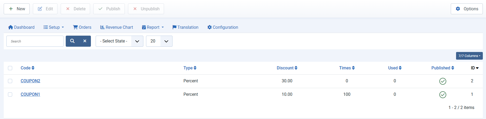
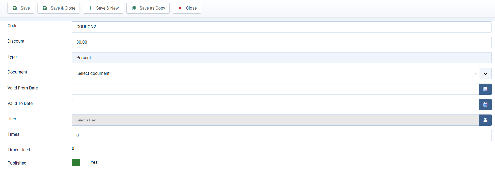

Coupons are discount codes that customers enter at checkout when buying digital downloads. You can offer a percentage discount across your store, a fixed amount off an order that includes a specific document, or a discount for a particular customer. Optional dates and a usage limit let you control when and how often a code can be redeemed.

## Enable coupons at checkout

In the Joomla administrator, open **Documents Seller → Configuration → General**, set **Enable Coupon** to **Yes**, and save. See [Checkout and Accounts](/getting-started/configuration/checkout-and-accounts) for related checkout settings.

## Create a coupon

Go to **Documents Seller → Coupons** and click **New**. To edit an existing coupon, click its code in the list.

| Setting | How to use it |
| --- | --- |
| **Code** | Enter the code customers will type at checkout, such as `SAVE10`. Use a different code for each offer. |
| **Discount** | Enter the numeric value. For example, enter `10` for 10% off with **Percent**, or 10 units of your store currency with **Amount**. |
| **Type** | Choose **Percent** for a percentage discount or **Amount** for a fixed discount. |
| **Document** | Select a document to require that product in the order. Leave **Select document** selected to make the coupon available for any document. |
| **Valid From Date** | Set the date and time when customers can start redeeming the code. Leave it blank to allow redemption as soon as the coupon is published. |
| **Valid To Date** | Set the date and time when the coupon expires. Leave it blank for no expiration. |
| **User** | Select a Joomla user to restrict the code to that account. The customer must sign in with that account before using the code. Leave the field blank to make the code available to any customer who can check out. |
| **Times** | Set the total number of uses across all customers. Enter `0` for unlimited use. |
| **Times Used** | Shows how many times the coupon has been used. Documents Seller updates this count automatically. |
| **Published** | Set to **Yes** to make the coupon available, subject to the restrictions above. Set to **No** to disable the coupon. |

Click **Save & Close**.

## Use a coupon at checkout

Enter one code in **Coupon Code**, then tab or click out of the field. Checkout recalculates the order automatically. Check **Discount Amount** and **Total Amount** before placing the order.

A percentage coupon for any document applies to the order subtotal. When you assign a percentage coupon to a specific document, Documents Seller calculates the discount on that document's price plus any custom field fees for the order. A fixed coupon deducts its amount once from the order subtotal, up to the subtotal. Documents Seller applies the discount before calculating tax and any payment processing fee.

Use the **Used** column in the coupon list to monitor redemptions. For online payments, the coupon counts when the payment succeeds. For offline payments, it counts as soon as the customer places the order, even while payment is pending.

## Why is the Coupon Code field missing?

Checkout shows **Coupon Code** when **Enable Coupon** is set to **Yes**, the order subtotal before discounts and taxes is greater than zero, and at least one coupon meets all of these conditions:

- **Published** is set to **Yes**.
- **Times** is `0`, or **Times Used** is below the **Times** limit.
- **User** is blank or matches the account currently signed in. Guests can use coupons with **User** left blank.
- **Document** is unassigned or matches a document in the current order.

If the field appears but checkout displays **The coupon code you entered is invalid**, check that the customer entered the code exactly as saved and that the specific coupon meets the conditions above. Also check **Valid From Date** and **Valid To Date**. Checkout checks the dates when it validates the entered code. A scheduled or expired coupon can therefore still cause the field to appear.
