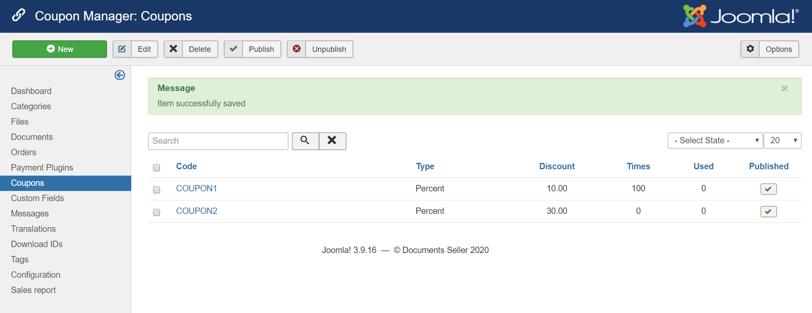
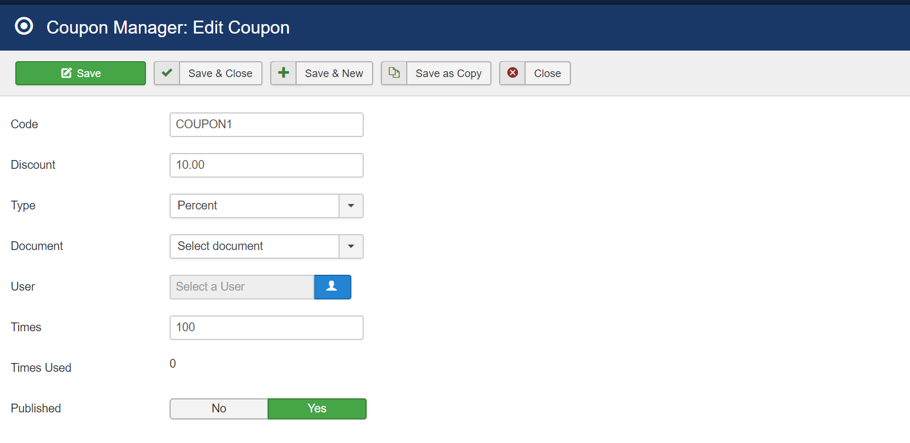

**Documents Seller** allows you to create coupon codes to give discount to your customers when they purchase your products.

Go to Documents Seller -> Coupons to access to Coupons Management screen.

## Add New Coupon
Press **New** button to create new coupon

1. **Code**: The code for this new coupon.
2. **Discount**: Enter the discount for this coupon. Discount can be set to a fixed amount (for example 10$) ro by percent (for example 10% of subscription fee).
3. **Type**: Percent or Fixed Amount.
4. **Document**: Choose the document this coupon code can be used. If no document is selected, the coupon code can be used to purchase any document and get discount,
5. **Times**: Enter number of times this coupon code can be used. If you set it to 0, the coupon code can be used unlimited times.
