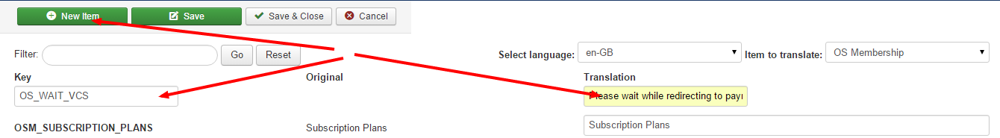

Translation is a very useful feature in **Documents Sellers**. It allows you to change existing language items, add new language items, translate the extension (both frontend and backend language files) to other languages without having to access to language file directly

Go to **Documents Seller** -> **Translations** to access to Translation page.

## Update / Change existing language items
If you need to update an existing languages items, on Translation management screen, search for that language item / language string, make the change, the press Save button in the toolbar to get it saved.

## Add New Language Item
Sometime, you will have to add a new language item to your language file. This usually needed when you install a new payment plugin and need to add extra language items to the extension

To do that, please follow the steps below:
1. Press **New Item** Button in the toolbar
2. Enter the **language key** into **Key** textbox
3. Enter the **language string** corresponding to that **language key** into **Translation** textbox
4. Press **Save** button in the toolbar

## Translate Language Files To New Language

If you use a none Engling language in Documents Seller and there is not a language package for that language avialable yet, you will need to translate language files of Documents Seller from English to your language. To do that, on Translation Mangement Screen:

1. Select the language you want to translate to in **Select language** dropdown
2. In the **Item to translate** dropdown, select **Frontend Language** if you want to translate frontend language file and **Backend Language** if you want to translate backend language file.
3. Do the translation
4. Press **Save** button in the toolbar

## Using Documents Seller in none English language
When you install **Documents Seller**, sample data (including emails messages, custom fields...) is generated using English language. In case you use **Documents Seller** in a different language, beside translate language items to your language, you will also have to translate some other items in the extension to your language:

1. **Translate Custom Fields**: Go to **Documents Seller -> Custom Fields**, edit the custom field, change the title (and description if available) to your language
2. **Translate Emails & Messages**: Go to **Documents Seller -> Messages**, translate all existing messages to your language.