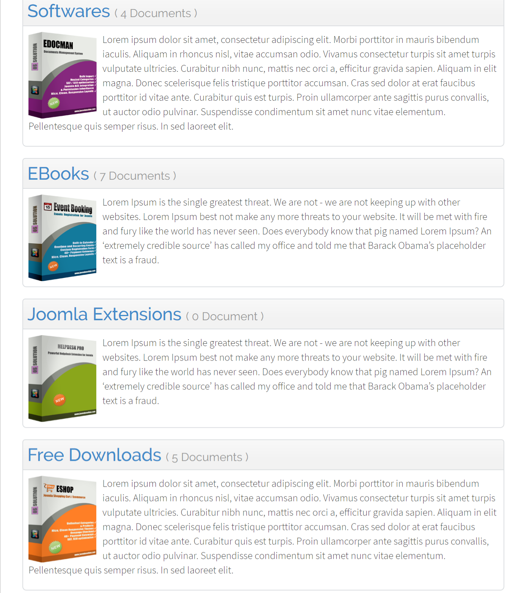

Categories page displayes list of categories which you setup in **Documents Seller** on your site. From that page, users can click on a category to see list of documents belong to that category.

To use this layout, you need to ceate a menu item to link to **Categories List** menu option of **DMS**. Before common Joomla menu items parameters, this menu option supports the following parameters specific to **Documents Seller**:

- **Select Category**: If you choose a category in this parameter, the system will display all children categories of that selected category, otherwise, top level categories will be displayed.

