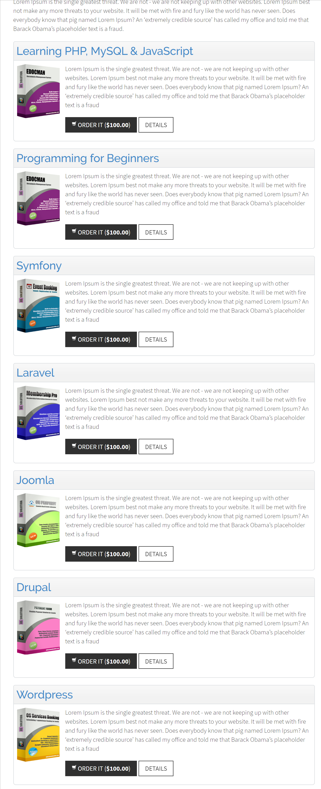

Use a category menu item to take customers directly to a list of documents. You can link to a single category, display the full catalog, or create a featured-products page.

## Choose a layout

When you [create the menu item](/frontend-menu-options#create-a-menu-item), choose one of these types under **Documents Seller**. The type sets the layout for this menu item.

| Menu item type | What customers see |
| --- | --- |
| **Category Default Layout** | A vertical list with space for each document's image and description. |
| **Category Column Layout** | Documents side by side. Set **Number Of Columns In Column Layout** in **Documents Seller → Configuration → Themes**. [View the columns example](/frontend-menu-options/category-columns-layout). |
| **Category Table Layout** | A compact table with one document per row. Use it when customers need to scan names and prices. [View the table example](/frontend-menu-options/category-table-layout). |
| **Category Grid Layout** | A grid of document cards. Use it for an image-led catalog with column and card settings on the menu item. |

Customers can open a document's details from the listing. The available order or download action depends on the document and the customer's access.

## Choose which documents to display

- **Select Category** limits the list to documents assigned to the selected category. Leave it set to **Top** to list documents across the catalog. Listings show published documents that the visitor can access.
- **Only Show Featured Documents** narrows the list to documents marked **Featured**. It works both for a selected category and with **Top**.
- A selected category's page also links to its visible subcategories. To include their documents in the parent listing, enable **Show Documents From Children Categories** in **Documents Seller → Configuration → General**. This includes documents from published subcategories at deeper levels as well.

For page size, sorting, and other shared display options, see [Storefront Display and URLs](/getting-started/configuration/storefront-display-and-urls).

## Configure the document grid

- **Number Columns** sets how many document cards appear per row. Choose 2, 3, 4, or 6. The default is 3.
- **Document Item Layout** controls the card design. Choose **Default** or **Image Top**. Use **Image Bottom** only if your Joomla template supplies an override for that layout.
- With **Image Top**, set **Enable Hover Effect** to **Yes** to highlight cards on hover. Use **Hover Background Color** and **Hover Text Color** to customize the effect, or leave the fields blank for the default colors.

The grid template displays the selected category's description when one exists. In the current version, **Show Category Description** and **Description Length Limit** on the **Category Grid Layout** menu item have no effect on the displayed text.
