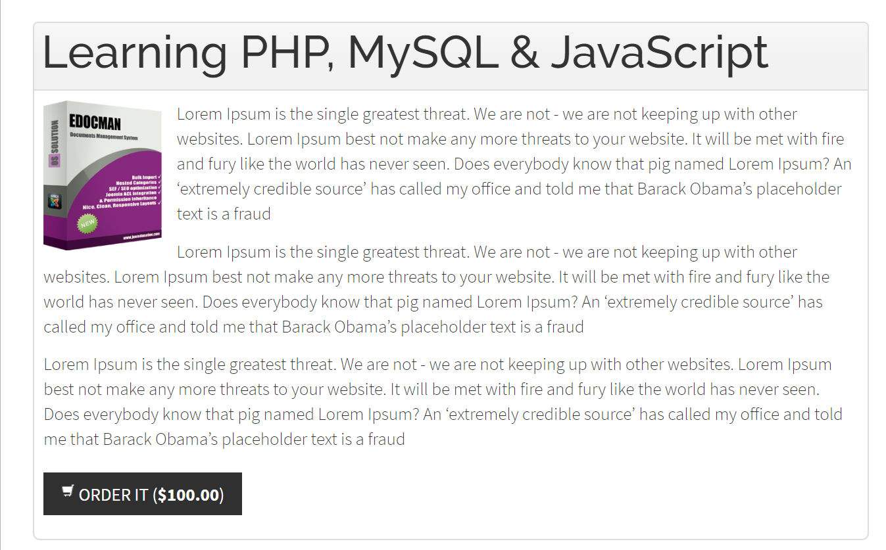

This menu option display detail information of a selected document. From that page, users can see the details information about the document and click on **Order** button to make the purchase.

To use this layout, you need to ceate a menu item to link to **Document Detail** menu option of **DMS**. Before common Joomla menu items parameters, this menu option supports the following parameters specific to **Documents Seller**:

- **Select Document**: You need to select the document which you want to display when users click on the menu item here. This is a mandatory parameter.

