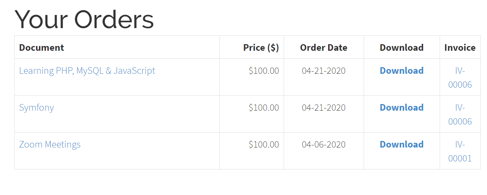

Use **Orders History** to give customers a place to find the documents they have purchased and download them again while eligible. The page is titled **Your Orders** when the page heading is shown.

When you [create the menu item](/frontend-menu-options#create-a-menu-item), choose **Orders History** under **Documents Seller**. It has no Documents Seller-specific menu settings. With **Public** access, guests who open the page are sent to the Joomla login form and returned to the page after signing in. Choose **Registered** if you want the menu link to appear only for signed-in customers.

## Which purchases appear

The list includes documents from paid or approved orders that match the signed-in customer's Joomla account ID or email address. A purchase made as a guest can therefore appear when the customer signs in with the same email address. If a purchase is missing, check the email on the order and whether the order is published. For offline payments, see [Orders Management](/orders-management) for the approval steps.

- **Download** is available while the document's download limit allows it. The page shows **Expired** once the allowed time or download count is exhausted.
- **Invoice** appears when **Activate Invoice Feature** is enabled. An order with a positive total and an invoice number has a link to its PDF invoice. See [Taxes and Invoices](/getting-started/configuration/taxes-and-invoices) to set up invoicing.

