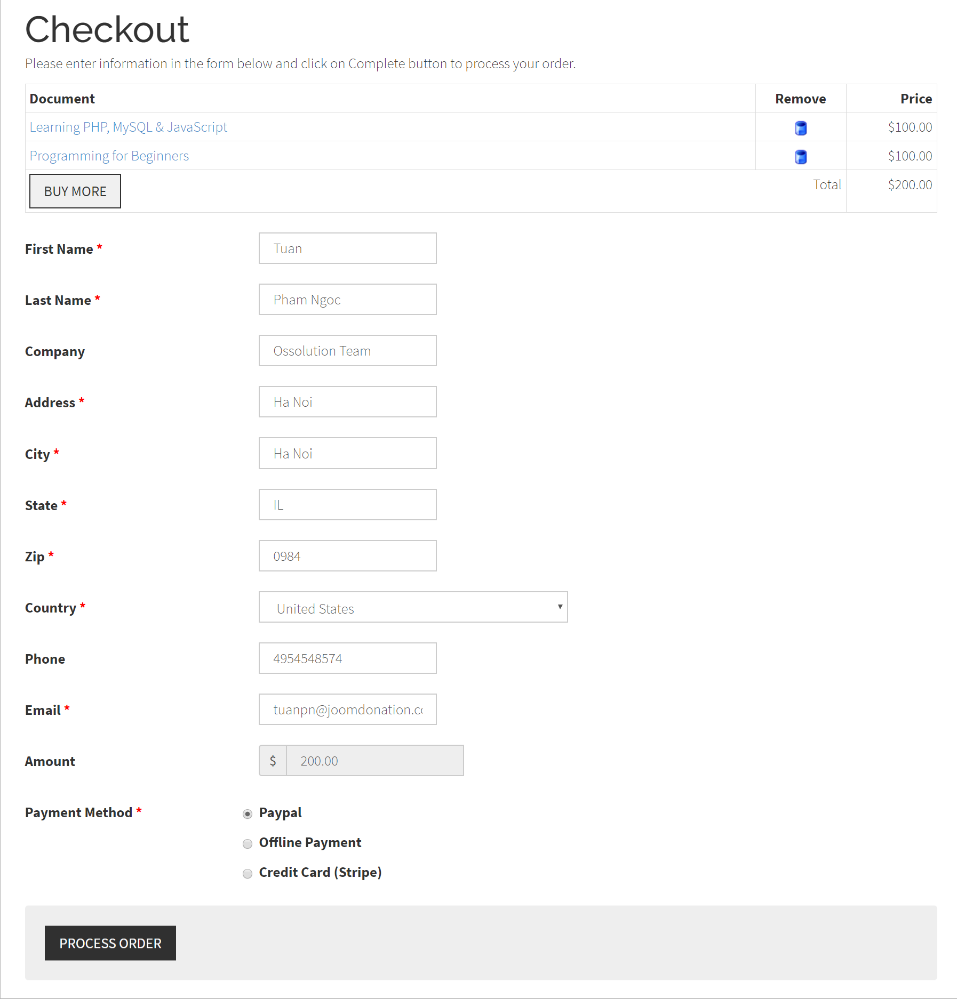

Use **Checkout** if you want customers to have a direct link to the checkout form after adding documents to their cart. This menu item is optional. Customers can also reach checkout through the normal order flow.

When you [create the menu item](/frontend-menu-options#create-a-menu-item), choose **Checkout** under **Documents Seller**. If checkout has no documents to show, visitors see **Your cart is empty** and return to the home page.

See [Checkout and Accounts](/getting-started/configuration/checkout-and-accounts) for cart and checkout settings. Publish the [DMS Cart module](/frontend-menu-options/modules#dms-cart) if you want customers to see their cart from other pages.

