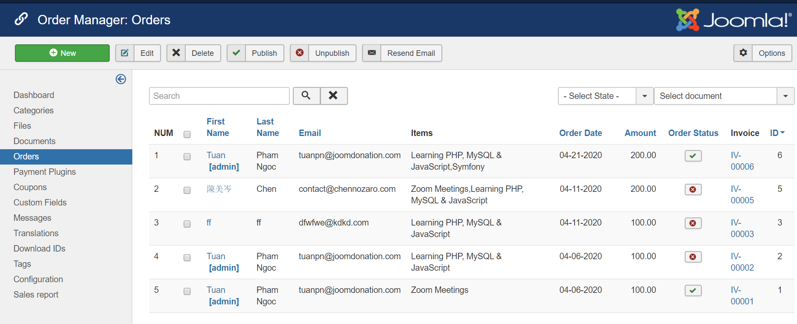
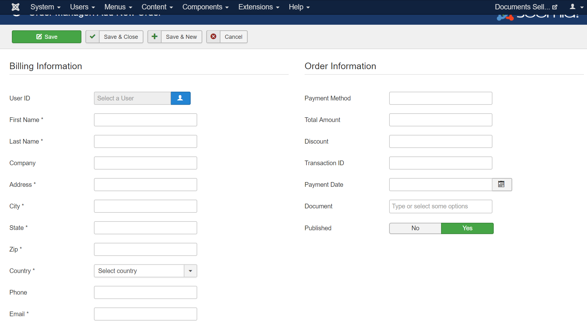
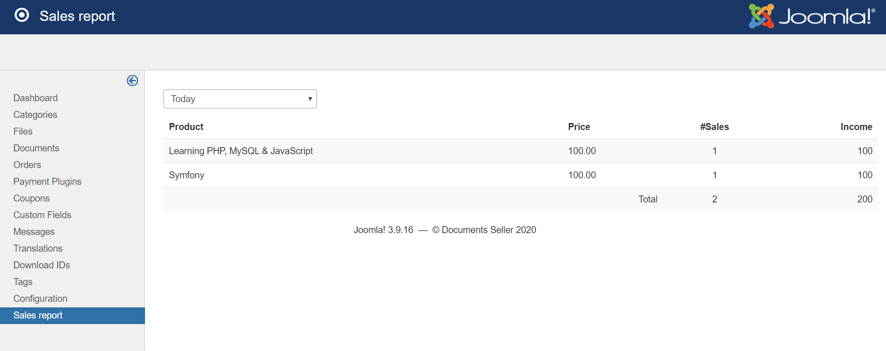

Go to Documents Seller -> Orders to access to Orders Management page from administrator area of your site. From that page, you can see all orders from your customer, approve (publish) orders, create new order manually.

## Add New Order
Sometime, you will need to create order manually for your customer (for example, they could not pay online and has to send payment to your manually). To do that, from Orders management page, just press New button in the toolbar to create a new order

## Publish/Approve Order
If you enable [offline payment method ](/setup/payment-plugins/offline-payment), and customers use that payment method for the order, you will have to publish/approve the order (when payment recieved) to allow customers to download the purchased documents from [Order History Page](/frontend-menu-options/orders-history)

There are two ways to publish an order:

- Check on the checkbox next to the order and press Publish button in the toolbar
- Or click on the red icon on that order (in Published column) to publish the order

When you publish an order, customer will receive an order approved email containing the purchased documents in the attachment. They can also acccess to Orders History page to download the order from there

## Sales Report
From this page, you will see an report about the sales of your documents in Today, This Week, This Month, Last Month, This Year. You will see what documents are sold and how many copies are sold, what's the income of each document in the selected time range

